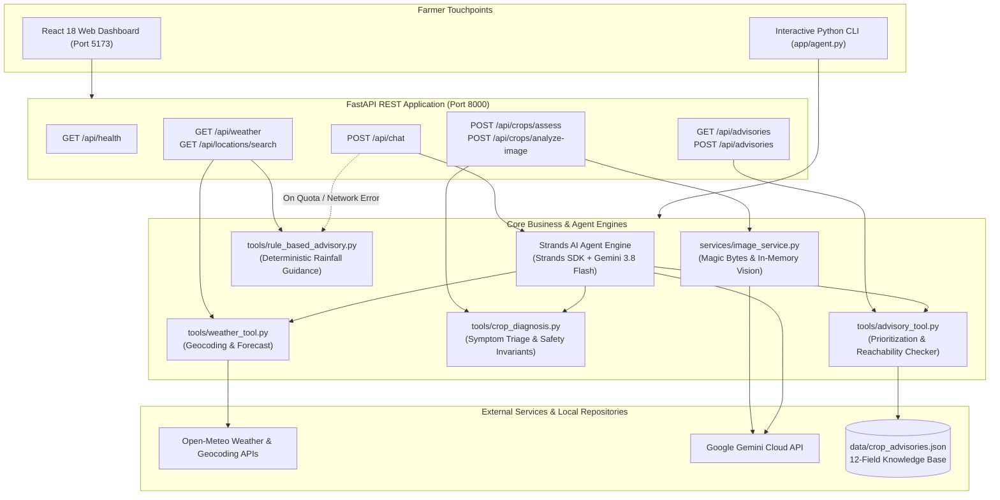

# KrishiRakshak AI (कृषिरक्षक) 🌾
**Agricultural Climate-Resilience Decision-Support System for Smallholder Farmers in Maharashtra, India**

*Built for the AWS Strands SDK: Workshop to Ship Hackathon*

---

## 1. Project Overview

**KrishiRakshak AI** is an open-source, climate-resilient agricultural decision-support system designed to empower smallholder farmers across Maharashtra, India. Tailored specifically for the Kharif cash crops—**Soybean (सोयाबीन)** and **Cotton (कापूस)**—KrishiRakshak AI couples hyper-local 3-day meteorological forecasts with deterministic farming guidance, objective symptom collection, cautious multimodal photograph interpretation, and verified institutional bulletins from ICAR research institutes and Maharashtra State Agricultural Universities.

Built using the **Strands Agents SDK** and **Google Gemini**, the application features an interactive multilingual AI assistant with automatic fallback resilience, a FastAPI REST backend, and a modern, mobile-responsive React dashboard.

---

## 2. Problem Statement

Smallholder farmers in the rainfed belts of Maharashtra (notably **Vidarbha**, **Marathwada**, and **Khandesh**) are disproportionately vulnerable to climate variability and agro-ecological shocks:

1. **Erratic Monsoon Dynamics**: Climate change has intensified weather unpredictability in Maharashtra. Sudden intense precipitation events cause flash waterlogging in heavy vertisol (black cotton) soils, while extended dry spells during crucial vegetative and flowering stages cause square and pod shedding.
2. **Untimely Chemical Applications**: Without reliable, local short-range rainfall forecasts, farmers frequently apply expensive chemical sprays immediately before rainfall events. The chemicals are washed away, contaminating groundwater, wasting scarce financial capital, and failing to protect crops.
3. **Pest Surges & Chemical Guesswork**: Pests such as **Pink Bollworm (*Pectinophora gossypiella*)** in Cotton and **Girdle Beetle (*Oberereopsis brevis*)** or **Stem Fly** in Soybean cause massive yield losses. In panic, farmers often resort to unverified chemical cocktails based on informal vendor advice, driving insecticide resistance, eradicating beneficial predatory insects, and exacerbating debt.
4. **The Extension Knowledge Gap**: While premier institutions (ICAR-IISR, ICAR-CICR, VNMKV, PDKV, MPKV) release regular seasonal advisories, this guidance is fragmented across PDF bulletins, websites with irregular uptime, and academic publications that rarely reach smallholders in accessible language.

---

## 3. Solution & Social Impact

KrishiRakshak AI addresses these challenges through a safety-first, deterministic approach:

- **🌦️ Timely, Actionable Weather Precautions**: Farmers search any village or district to receive 3-day rain probability (%) and volume (mm) with deterministic rules: when to delay sowing, when to pause irrigation, and when to halt pesticide spraying to avoid chemical runoff.
- **🛡️ Responsible AI & Zero-Dosing Policy**: The platform enforces an absolute safety invariant: **it never prescribes pesticide, herbicide, or fertilizer dosages based on symptom questionnaires or uploaded photographs alone.** It separates observations from unconfirmed diagnoses and directs farmers to physical Krishi Vigyan Kendra (KVK) diagnostic clinics with fresh field specimens.
- **📸 Objective Visual Triage**: Farmers can photograph damaged leaves or bolls. Multimodal vision models provide structured, cautious visual signs (*"interveinal chlorosis observed"*, *"possible explanation: iron deficiency or early fungal spot"*) while explicitly detailing photographic limitations (glare, hidden leaf undersides).
- **📚 Verified Institutional Knowledge**: Aggregates verified guidance from central ICAR institutes, state agricultural universities, and district KVKs. Enforces the principle that **URL reachability is not proof of seasonal validity**, clearly labeling historical baseline bulletins from past years.
- **🌱 Economic Empowerment for Smallholders**: By preventing wasted chemical applications and encouraging low-cost cultural practices (Broad Bed Furrowing, pheromone traps, drainage furrows, seed germination testing), KrishiRakshak AI protects smallholders' capital and improves crop survival rates.

---

## 4. Features Actually Implemented

| Module | Implemented Capabilities |
|---|---|
| **Weather & Rainfall Forecast** | • Open-Meteo geocoding search across Maharashtra villages, talukas, and districts.<br>• 3-day forecast: daily rain probability (%), rainfall sum (mm), and WMO weather codes.<br>• Deterministic field advice (soil drainage, spraying windows, irrigation halts).<br>• Clear notices that forecasts change and are not crop prescriptions. |
| **Crop Symptom Assessment** | • Structured symptom input for **Soybean** and **Cotton**.<br>• Records growth stage, plant parts, duration, field distribution, soil moisture, and recent rain.<br>• Highlights missing observations needed for proper identification.<br>• Outlines non-chemical field inspection checklists without guessing chemical treatments. |
| **Multimodal Crop Photo Analysis** | • In-memory validation of image size (up to 10 MB) and MIME types (JPEG, PNG, WebP).<br>• Magic header byte validation (`\xff\xd8\xff`, `\x89PNG`, `RIFF...WEBP`) to reject corrupt or disguised files.<br>• Multimodal analysis via vision-capable models (`gemini-3.8-flash`), rejecting text-only models.<br>• Returns structured JSON: visible plant parts, observable symptoms, quality limitations, possible non-confirmed explanations, and safe cultural next steps.<br>• Zero disk retention: uploaded photos are handled in memory and never stored. |
| **Knowledge Base & Source Verification** | • Standardized **12-field schema** covering ICAR-IISR, ICAR-CICR, VNMKV, PDKV, MPKV, KVK Jalna, KVK Yavatmal, and Maharashtra Krishi Vibhag.<br>• Relevance and freshness ranking: verified current regional guidance appears first; historical references appear last with warning alerts.<br>• Network reachability test verifies institutional portal connectivity (HTTP status, redirects, timeouts) without conflating reachability with content validity. |
| **Multilingual AI Assistant** | • Conversational agent built with the **Strands Agents SDK** and Gemini.<br>• Context-aware: automatically incorporates confirmed location and 3-day weather forecast.<br>• Supports English, Hindi, and Marathi prompts.<br>• **Graceful Fallback**: Automatically degrades to deterministic rule-based advice if Gemini hits quota limits (429) or service outages (503). |
| **Interactive Web Dashboard** | • Responsive React 18 + Vite 8 dashboard with 6 specialized pages.<br>• Form validation, loading spinners, error alerts, empty states, and accessible form labels.<br>• Visual styling in agricultural green, warm earth tones, and clean cards. |

---

## 5. Technology Stack

- **Agent Framework**: [AWS Strands Agents SDK](https://github.com/strands-agents/strands) (`strands-agents[gemini]`)
- **Large Language & Vision Models**: Google Gemini (`gemini-3.8-flash`) via Google GenAI SDK
- **Backend Web Framework**: FastAPI (Python 3.13), Uvicorn, Pydantic v2
- **Frontend Framework**: React 18, Vite 8, Lucide React Icons, CSS3
- **External Meteorological Data**: Open-Meteo Geocoding & Weather Forecast APIs (Free, no API key required)
- **Knowledge Base**: Curated local JSON repository (`data/crop_advisories.json`)
- **Testing & Verification**: pytest (204 automated unit and integration tests with mocked external calls)

---

## 6. Architecture & Data Flow



---

## 7. Data Sources and Their Roles

| Source / Institution | Category | Role in KrishiRakshak AI | Geographic Focus |
|---|---|---|---|
| **Open-Meteo API** | Meteorological Service | Real-time geocoding search and 3-day forecasts (precipitation probability, rain sum, weather codes). | Global / Maharashtra coordinates |
| **ICAR-IISR Indore** | Central ICAR Institute | National soybean authority; provides recommendations on Broad Bed Furrowing (BBF), seed treatment, and drainage. | Maharashtra & Central India |
| **ICAR-CICR Nagpur** | Central ICAR Institute | National cotton authority; provides surveillance guidelines for Pink Bollworm (PBW), pheromone trap thresholds, and refuge planting. | Vidarbha & Central India |
| **VNMKV Parbhani** | State Agricultural University | Regional university package of practices for Marathwada; varietal recommendations (MAUS series) and sucking pest alerts. | Marathwada (8 districts) |
| **Dr. PDKV Akola** | State Agricultural University | Regional university package of practices for Vidarbha; vertisol drainage channels and high-density cotton guidance. | Vidarbha (11 districts) |
| **MPKV Rahuri** | State Agricultural University | Regional university guidance for Western Maharashtra; intercropping ratios (Soybean + Tur) in scarcity zones. | Western Maharashtra |
| **KVK Jalna & Yavatmal** | Farm Science Centers (ICAR) | District-level frontline demonstrations, diagnostic clinics, and seasonal field threshold alerts. | Jalna & Yavatmal Districts |
| **Department of Agriculture, Maharashtra** | State Government Dept | On-farm seed germination testing standards (minimum 70% threshold) and input quality regulations. | Entire Maharashtra State |

---

## 8. Installation Instructions for Windows

### Prerequisites
- **Operating System**: Windows 10 or 11
- **Python**: Version 3.11 or higher (Python 3.13 recommended)
- **Node.js**: v18.0.0 or higher
- **npm**: v9.0.0 or higher
- **Git**: Installed and configured on your system

### Step 1: Open PowerShell
Open PowerShell as a standard user and navigate to your desired workspace:
```powershell
cd D:\KrishiRakshak-AI
```

### Step 2: Set Up Python Virtual Environment
1. Create a virtual environment named `.venv`:
   ```powershell
   python -m venv .venv
   ```
2. Activate the virtual environment:
   ```powershell
   .\.venv\Scripts\Activate.ps1
   ```
   *(If script execution is blocked on Windows, run `Set-ExecutionPolicy -Scope Process -ExecutionPolicy Bypass` and reactivate).*
3. Upgrade pip and install backend dependencies:
   ```powershell
   python -m pip install --upgrade pip
   pip install -r requirements.txt
   ```

### Step 3: Install Frontend Dependencies
Navigate to the `frontend/` directory and install npm packages:
```powershell
cd frontend
npm install
cd ..
```

---

## 9. Environment Variable Setup

The repository provides a template file [`.env.example`](file:///d:/KrishiRakshak-AI/.env.example) containing only safe placeholder values.

1. Copy the example file to `.env`:
   ```powershell
   Copy-Item .env.example .env
   ```
2. Open `.env` in a text editor (e.g. Notepad) and configure your credentials:
   ```env
   # =====================================================================
   # KrishiRakshak AI — Environment Variables Template
   # =====================================================================

   # Google Gemini API Key (Required for AI assistant & multimodal photo analysis)
   # Obtain a free key from: https://aistudio.google.com/app/apikey
   GOOGLE_API_KEY=your_actual_gemini_api_key_here

   # Gemini Vision Model Name (Optional; defaults to gemini-3.8-flash)
   GEMINI_VISION_MODEL=gemini-3.8-flash

   # Allowed CORS Origins for FastAPI (Optional; comma-separated for production)
   # ALLOWED_ORIGINS=https://your-production-domain.com,http://localhost:5173
   ```
> [!IMPORTANT]
> The `.env` file is excluded from git via `.gitignore`. Never commit, share, or publish your actual API keys.

---

## 10. How to Run the Project

### Option A: Full Web Dashboard (Recommended)

1. **Terminal 1 — Start the FastAPI Backend (Port 8000)**:
   ```powershell
   cd D:\KrishiRakshak-AI
   .\.venv\Scripts\Activate.ps1
   .\.venv\Scripts\python.exe -m uvicorn api.main:app --host 127.0.0.1 --port 8000 --reload
   ```
   - Swagger API Documentation: `http://127.0.0.1:8000/docs`
   - Health Check: `http://127.0.0.1:8000/api/health`

2. **Terminal 2 — Start the React Vite Frontend (Port 5173)**:
   ```powershell
   cd D:\KrishiRakshak-AI\frontend
   npm run dev
   ```
   - Web Application Dashboard: `http://127.0.0.1:5173`

### Option B: Interactive Command Line Interface (CLI)
You can interact with KrishiRakshak AI directly in your terminal without starting the web frontend:
```powershell
cd D:\KrishiRakshak-AI
.\.venv\Scripts\Activate.ps1
.\.venv\Scripts\python.exe app\agent.py
```
- Type `weather` to inspect the 3-day forecast for any location in India without calling Gemini.
- Type `crop` to perform a structured symptom triage for Soybean or Cotton offline.
- Type any farming question in Marathi, Hindi, or English to chat with the AI assistant.
- Type `exit` to quit.

---

## 11. How to Run Automated Tests

The codebase includes **204 automated unit and integration tests** covering weather tools, crop diagnosis, knowledge base schemas, image validation, and API routes.

All external calls (Open-Meteo and Google Gemini) are **100% mocked in automated tests**, ensuring that running the test suite is instantaneous, consumes zero API quota, and requires no active internet connection.

### Run Backend pytest Suite
```powershell
cd D:\KrishiRakshak-AI
.\.venv\Scripts\Activate.ps1
.\.venv\Scripts\python.exe -m pytest tests/ -v
```
*Expected result: 204 passed in ~2.5 seconds with 0 failures.*

### Verify Frontend Production Build
```powershell
cd D:\KrishiRakshak-AI\frontend
npm run build
```
*Expected result: 0 errors; produces optimized production static assets in `frontend/dist/`.*

---

## 12. Security & Responsible AI Safeguards

1. **Credential Isolation**: Secrets are read exclusively from environment variables on the backend. No API keys appear in frontend client bundles or static assets.
2. **Log Sanitization**: Error handlers include automatic token redactors (`_redact_api_key`) to prevent sensitive API keys from appearing in terminal logs or response traces.
3. **In-Memory File Processing**: Uploaded photographs are inspected as byte buffers in RAM and discarded immediately after processing. No farmer images are saved to local disk.
4. **File Validation & Anti-Spoofing**: Enforces a 10 MB file size limit and verifies true file header magic bytes (`\xff\xd8\xff` for JPEG, `\x89PNG\r\n\x1a\n` for PNG, and `RIFF...WEBP` for WebP).
5. **No Hallucinated Dosing**: KrishiRakshak AI strictly prohibits prescribing chemical herbicide, pesticide, or fertilizer dosages. All assessments provide cultural field practices and refer farmers to physical KVK laboratories.
6. **Graceful Degradation**: If Google Gemini encounters quota limits (HTTP 429) or network outages, KrishiRakshak AI automatically provides deterministic rule-based advice rather than failing.

---

## 13. Limitations & Future Roadmap

### Current Limitations
- **Crop Scope**: Focused on Maharashtra's primary Kharif cash crops—**Soybean** and **Cotton**.
- **Connectivity**: The web dashboard requires connectivity to the local backend. Full offline field operation is currently supported via the interactive CLI (`python app/agent.py`).

### Future Roadmap
- **Crop Expansion**: Adding knowledge bases and diagnostic trees for Sugarcane (*ऊस*), Pigeonpea/Tur (*तूर*), Chickpea/Gram (*हरभरा*), and Onion (*कांदा*).
- **Progressive Web App (PWA)**: Adding service workers and client-side IndexedDB caching so the web dashboard can operate in remote fields without cellular data.
- **IVR / Voice Gateway**: Integrating an automated toll-free voice/SMS gateway (e.g. AWS Amazon Connect or Twilio) for feature-phone users who cannot access web browsers.
- **Multimodal Audio**: Supporting speech-to-speech in rural Marathi dialects (e.g., Varhadi, Marathwada regional dialects).

---

## 14. License

This project is licensed under the **MIT License** — see the `LICENSE` file for details. Built for open, transparent, and public good agricultural resilience.
